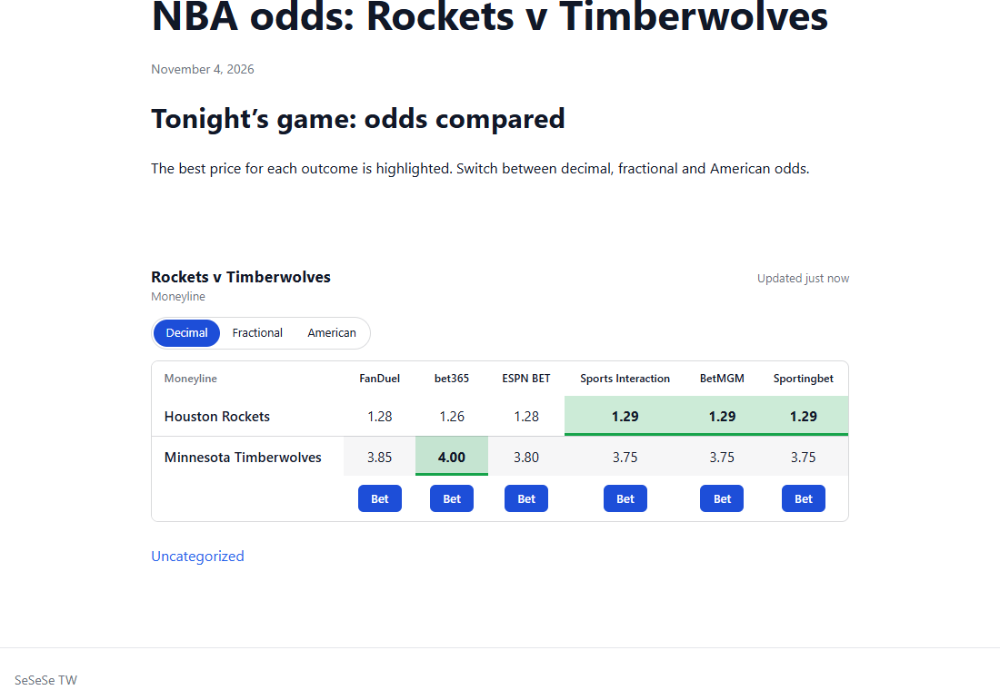
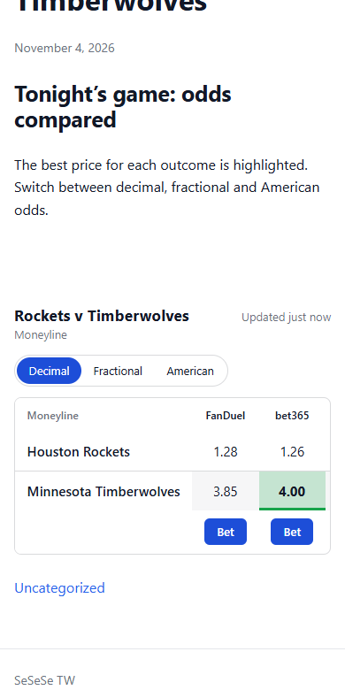
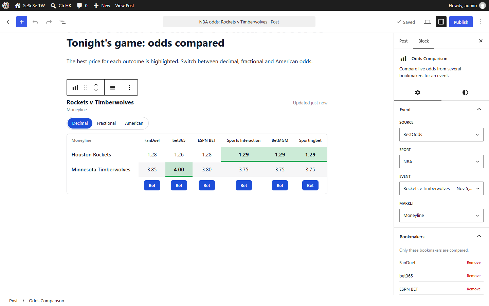
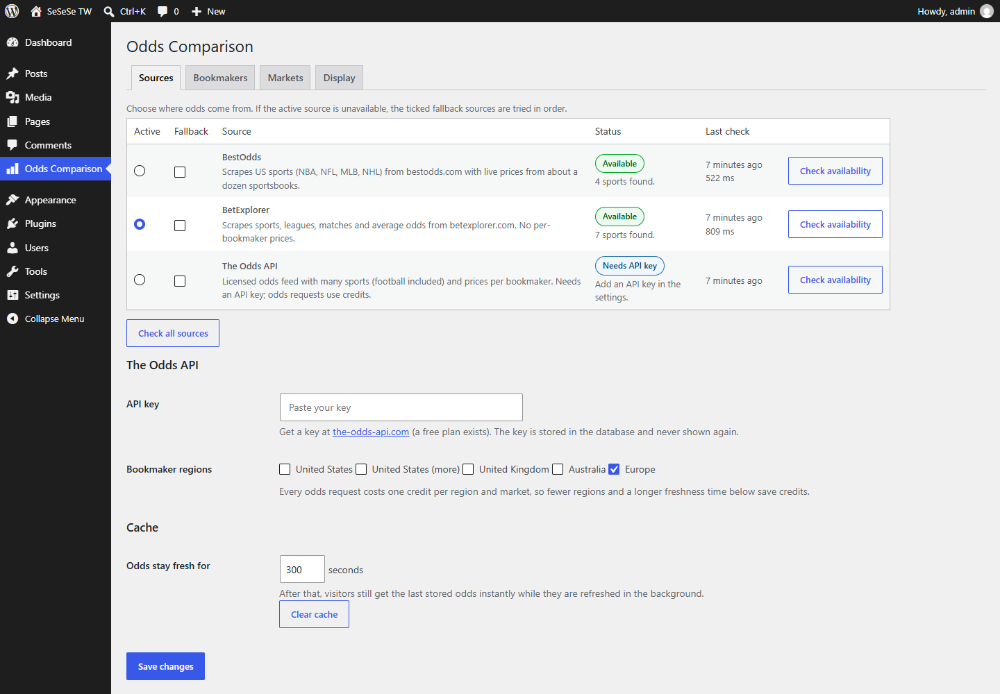
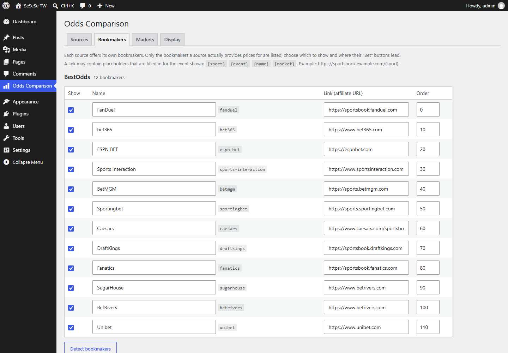

# Odds Comparison

A WordPress plugin that compares live odds from many bookmakers. Editors add a
**Gutenberg block**, pick a sport, an event and a market, and visitors see a
responsive table with the best price highlighted and a decimal / fractional /
American odds switcher. Odds are scraped from public odds sites and cached in
custom database tables.

- Requires WordPress 6.5+ and PHP 8.1+. It has no runtime dependencies; Composer and
  Node are only used for development tools (tests, coding standards, the block build).
- Built assets are committed, so the plugin works straight after cloning;
  Node is only needed to change the block's JavaScript.

## Screenshots

**The block on a page** (desktop and phone). The best price of each outcome is
highlighted, the visitor can switch odds format, and the table scrolls sideways
on narrow screens while the outcome names stay in view.





**The block in the editor**: pick the event and market, and add or remove
bookmakers in the sidebar. The preview is exactly what visitors will see.



**The dashboard**: choose the source and see whether each one is available (with a
one-click re-check), set the Odds API key and regions, and manage bookmakers per
source.





*The screenshots were taken from a running site with live BestOdds data.*

## Features

| Area | What it does |
| --- | --- |
| **Sources** | Pluggable sources behind one interface. Ships with **BestOdds** (scraped; per-bookmaker prices for NBA, NFL, MLB, NHL), **BetExplorer** (scraped; sports, leagues, matches and average prices) and **The Odds API** (licensed feed with an API key; many sports including football, per-bookmaker prices, optional deep links to the bet). |
| **Admin dashboard** | Pick the active source and fallbacks, see each source's availability and re-check it with one click, choose bookmakers per source, set their links, enable markets, set the default odds format. |
| **Gutenberg block** | Sport → event → market pickers, add or remove bookmakers, live editor preview, highlight-best and format-switcher toggles. |
| **Odds conversion** | Decimal, fractional and American, converted client-side without reloading; the visitor's choice is remembered. |
| **Performance** | Odds are stored per source/event/market, served instantly when fresh, fetched under a lock when not, and the page itself stays cacheable (odds load asynchronously). |
| **Respectful scraping** | Honest user agent, `robots.txt` obeyed, per-host throttling, `Retry-After`, circuit breaker. Bot-protection challenges are reported, never bypassed. |

## Installation

1. Copy the `odds-comparison` folder to `wp-content/plugins/` (or clone this repository there).
2. Activate **Odds Comparison** in *Plugins*. Activation creates two database tables; they are also created or migrated automatically when the schema version changes.
3. Open **Odds Comparison** in the admin menu:
   - **Sources**: the active source defaults to BestOdds. Click *Check availability* to see its status. For football and European bookmakers, paste a [The Odds API](https://the-odds-api.com) key (a free plan exists), pick the bookmaker regions, and select *The Odds API* as the active source.
   - **Bookmakers**: click *Detect bookmakers* for a source to load the bookmakers it provides, then set your affiliate links.
4. Edit a post or page, add the **Odds Comparison** block and choose a sport, event and market.

Deleting the plugin removes its tables, options and cached data.

## Development

```bash
npm install        # once
npm run dev        # watch and rebuild the block
npm run build      # production build into build/
npm run lint:js    # lint the block JavaScript
npm run format     # format it

composer install        # once: PHPUnit, WordPress Coding Standards, WordPress test library
composer test           # unit tests, no WordPress or database needed
composer lint           # WordPress Coding Standards (security, escaping, SQL, i18n, prefixes)
composer test:integration   # integration tests on a real WordPress, see below
composer test:all       # unit + integration
```

**Integration tests** boot a real WordPress with the plugin loaded and use a real
database. Point them at a WordPress installation and an **empty, disposable**
database (the suite drops every table in it, so never use a real site's database):

```bash
export WP_CORE_DIR=/path/to/wordpress          # core files only are used
export WP_TESTS_DB_NAME=wordpress_test WP_TESTS_DB_USER=root WP_TESTS_DB_PASSWORD= WP_TESTS_DB_HOST=127.0.0.1
composer test:integration
```

Source lives in `blocks/odds-table/`; `build/` is generated and committed.
PHP follows PSR-12 layout with `declare(strict_types=1)` and the `OddsComparison\`
namespace, autoloaded by `src/autoload.php`; the WordPress-specific rules that matter
for safety are enforced with WPCS (see [phpcs.xml.dist](phpcs.xml.dist)).

## Documentation

- [docs/DOCUMENTATION.md](docs/DOCUMENTATION.md): structure, data flow, caching, database, REST API, security.
- [docs/EXTENDING.md](docs/EXTENDING.md): add a source, a bookmaker, an odds format, a market; hooks and filters reference.
- [CHANGELOG.md](CHANGELOG.md)

## Good to know

- **Oddschecker** (the example site in the brief) sits behind a Cloudflare bot challenge: every request is answered with `403` and `cf-mitigated: challenge`. The plugin does not try to bypass this. The source architecture is meant for exactly this situation: other sources are used, and a source that becomes unavailable is shown as *Blocked* in the dashboard.
- **BestOdds** covers US sports and US sportsbooks only. **BetExplorer** exposes one aggregated price, not prices per bookmaker. For European football with per-bookmaker prices use **The Odds API**; its odds requests spend credits (one per region and market), so keep the freshness time generous on a free plan.
- The "Bet" button opens the link you set for the bookmaker. Links may contain `{sport}`, `{event}`, `{name}` and `{market}`. The scraped sources do not know a bookmaker's own event ids, so their links cannot point at one specific bet slip; The Odds API can supply deep links, which are used unless you set your own link.
- Scraped sites can change their markup. The dashboard reports this as *Parser mismatch*.
- Check the terms of use of any site you scrape before using this on a production site.

## License

GPL-2.0-or-later. See [LICENSE](LICENSE).
